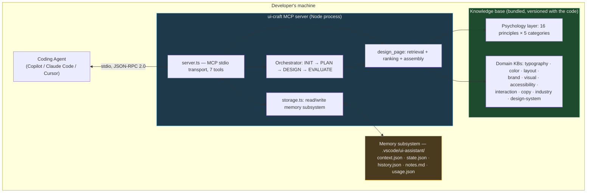
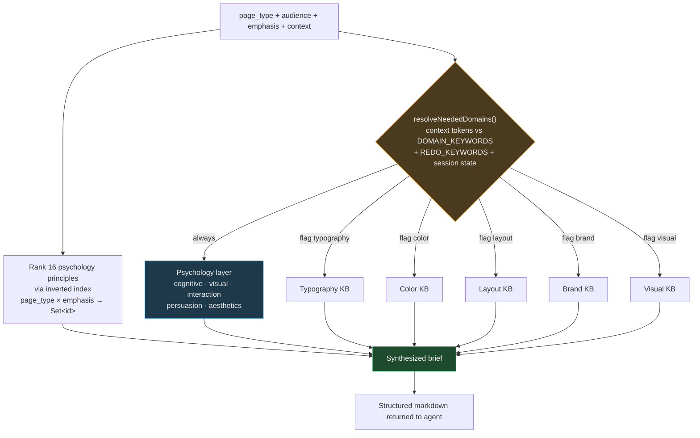
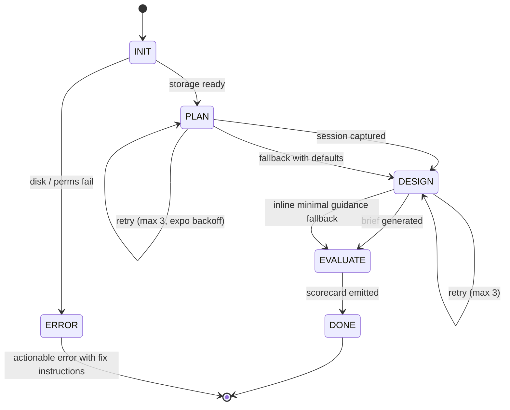
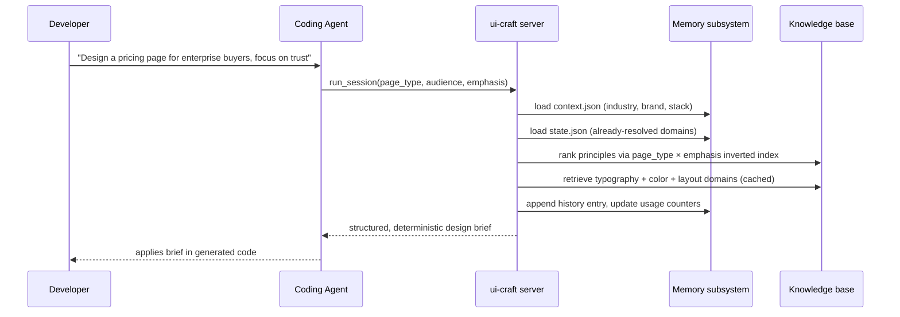

# UI Craft: A Persistent, Retrieval-Grounded MCP Server for Personalizing and Stabilizing LLM-Assisted UI Design

**Working paper draft — v0.1**
*Author: Chinmoy Mitra*
*System version referenced: `@chinmoy_mitra/ui-craft` v0.4.6 (open source, Apache 2.0)*
*Code: https://github.com/Chinmoy17/UI_Assitant_AI*

---

## Abstract

Large language model (LLM) coding agents can write functional UI code but consistently default to generic, unprincipled layout, typography, and color decisions unless steered by explicit design knowledge. The common workaround — a static project instruction file (`skill.md`, `AGENTS.md`, `.cursorrules`) injected into every prompt — provides *information availability* but neither *personalizes* to a specific project over time nor *constrains* the variance of the agent's output across repeated invocations of the same task.

We present **UI Craft**, an open-source Model Context Protocol (MCP) server that reframes design knowledge as a set of callable, retrieval-grounded tools rather than as static prompt content. UI Craft makes two testable claims: (1) it enables **lightweight, local, fine-tuning-free personalization** of an LLM agent's design output to a specific project through a persistent, inspectable, feedback-updatable memory layer; and (2) it **measurably improves output consistency** relative to static context injection through a structured retrieval-and-cache architecture — an inverted-index-backed knowledge base, a three-state singleton cache, and a progressive session-state mechanism that prevents the agent from re-litigating decisions already settled within a session.

This document states these claims precisely, describes the system architecture and mechanisms that realize them, proposes an evaluation plan that operationalizes both claims into measurable studies, and outlines a generalization path beyond UI design — toward a reusable architectural pattern for personalizing and stabilizing any LLM coding agent's behavior around a persistent, project-scoped memory of preferences and prior decisions.

---

## 1. Motivation

Coding agents integrated into IDEs (GitHub Copilot, Claude Code, Cursor) now handle a large share of UI implementation work. Ask one to "design a landing page," however, and the result is typically visually plausible but design-naive: default spacing, arbitrary type scale, no grounding in cognitive or perceptual research (Gestalt grouping, Fitts's Law, Hick's Law, the Halo Effect, F-pattern reading behavior, and related UX literature).

Developers currently address this in one of three ways:

1. **Manual instruction** — describing design intent in the prompt each time. High effort, not reusable, and the agent forgets on the next session.
2. **Static instruction files** — `skill.md` / `AGENTS.md` / `copilot-instructions.md` committed to the repo and injected into every agent turn. Solves the "forgets between sessions" problem but introduces three new problems we detail in §2.3: no project-specific adaptation, a fixed context-window cost on every turn, and no mechanism enforcing that the agent applies the same rules the same way across calls.
3. **Nothing** — accept the generic output and fix it manually afterward.

UI Craft is an attempt to give the agent a fourth option: a **callable design-knowledge tool** with **persistent, per-project state** and a **retrieval architecture** that behaves the same way every time it is asked the same question. This reframes two properties — personalization and consistency — as *system design problems*, not prompt-engineering problems.

---

## 2. Contributions and Claims

This section states the contributions precisely enough to be falsifiable, and explains how the rest of the paper (and a future evaluation) should be organized around them. This is deliberately placed before the architecture section, per the framing of this document: **claims first, mechanism second**.

### 2.1 Contribution 1 — Lightweight LLM Personalization Without Fine-Tuning

**Claim.** UI Craft introduces a lightweight, local-first mechanism for personalizing an LLM coding agent's design output to a specific project, without fine-tuning and without re-sending full context on every call.

**Supporting mechanisms** (detailed in §5):

- **Persistent per-project memory (`context.json`).** Once a developer sets project-level facts — brand color, target audience, industry, tone, stack, density preference, must-keep constraints — the agent does not need to restate them on every request. They persist on disk and are read automatically on every subsequent tool call scoped to that project.
- **Feedback-driven adaptation (`notes.md`, `history.json`).** The system supports an explicit, accumulating feedback loop. A developer can leave a note ("avoid serif for this brand," "audience skews enterprise, not consumer") and future generations for that project incorporate it. This is personalization that *accumulates through use* rather than a fixed, one-shot preference file authored once and never revisited.
- **Mechanism, not black box.** Because personalization is implemented as structured, inspectable JSON state — not embedded in model weights or a hidden embedding — it is fully auditable. A reviewer (or the developer) can literally open `context.json` and `history.json` and see what the agent "remembers" about a project and how that memory changed after specific feedback events.

**Why this is the more defensible claim of the two.** A static context file (`skill.md`) has no notion of *which* project it is being used for beyond whatever text a human manually wrote into it — it is the same generic instructions every time, for every project, unless a human edits it. UI Craft's contribution is making the design guidance **project-aware and adaptive over time**, which is a qualitatively different capability, and one that maps directly onto active research interest in LLM personalization without weight updates (see §4).

### 2.2 Contribution 2 — A Retrieval-and-Cache Architecture for Output Consistency

**Claim.** UI Craft improves the reliability and repeatability of agent-generated UI guidance by grounding generation in a fixed, structured knowledge base retrieved deterministically, rather than relying on the model's free-floating priors to reconstruct design rationale from memory on each call.

**Supporting mechanisms** (detailed in §5):

- **Structured principle retrieval via inverted index.** Instead of the agent improvising design rationale from its training-data priors each time (which is known to vary run-to-run even at temperature 0, and varies substantially across models and providers), the system retrieves a scoped, deterministic set of principles keyed to `page_type × emphasis`. The same query against the same knowledge base returns the same grounded entries every time — retrieval, not regeneration.
- **Three-state singleton knowledge-base cache.** Reduces variance introduced by re-deriving or re-fetching design knowledge on every call. The exact same principle content, typography rules, color tokens, and layout rules are reused by reference across a session rather than being re-parsed, re-summarized, or re-generated.
- **Progressive session state.** Once a design domain (e.g., typography, color) has been resolved for a project within a session, the system records that the domain is settled. This prevents the agent from re-litigating or silently contradicting an earlier decision later in the same session — a direct, structural mechanism for **within-session consistency**, not just a suggestion in a prompt.

**Why the baseline lacks this property.** A static `skill.md` gives the model the same raw material every time, but nothing prevents the model from *interpreting or applying* that material differently from call to call — availability of information is not the same as consistency of application. UI Craft's retrieval-and-cache architecture is what actually constrains output variance; the static-file baseline only constrains what information is *available*, not what the model *does* with it.

### 2.3 Contrast Table — UI Craft vs. Static Context Injection (`skill.md`)

| Property | Static `skill.md` / `AGENTS.md` | UI Craft |
|---|---|---|
| Same information every call | Yes | Yes (deterministic retrieval) |
| Project-aware (adapts per project) | No — manually edited per project, if at all | Yes — `context.json` is read and applied automatically |
| Improves from feedback over time | No — requires manual file edits | Yes — `notes.md` / `history.json` accumulate |
| Context-window cost per turn | Fixed, ~3–5k tokens, resident every turn regardless of relevance | Near-zero until a tool is called; response scoped to only the domains needed |
| Enforces consistent application across calls | No mechanism — model reinterprets each time | Yes — cached retrieval + progressive session state prevent re-litigation |
| Auditable state | Only the file itself (static) | Full inspectable state: `context.json`, `state.json`, `history.json`, `notes.md` |
| Scales across many projects | Requires copy-paste + manual tailoring per project | One universal MCP install; state is per-project by construction |

### 2.4 One-Line Framing for a Contributions List

> *"We introduce a persistent, project-scoped memory mechanism enabling lightweight LLM personalization without fine-tuning (Contribution 1), coupled with a structured retrieval-and-cache architecture that measurably improves output consistency relative to static context injection (Contribution 2)."*

### 2.5 How This Should Shape the Rest of the Paper

Both claims are currently **architecturally supported** (the mechanisms exist and are described precisely in §5) but only **Contribution 1 has an associated evaluation design** so far (Study 3, §6.2). **Contribution 2 does not yet have an empirical study measuring output variance** — §6.3 proposes the missing study explicitly, because a paper claiming "improves consistency" needs a run-to-run variance measurement, not just an architecture description. This gap is stated plainly in §7 (Limitations) as well, so it is not silently glossed over.

---

## 3. System Overview

UI Craft is a Node.js process implementing the Model Context Protocol (MCP), installed via a single JSON configuration block (`npx -y @chinmoy_mitra/ui-craft@latest`) into any MCP-compatible agent host (GitHub Copilot in VS Code, Claude Code, Cursor). It exposes **seven tools**:

| Tool | Role |
|---|---|
| `run_session` | Orchestrated end-to-end session: `INIT → PLAN → DESIGN → EVALUATE`. All inputs optional; resolved from stored context, freeform-text inference, or defaults. |
| `design_page` | Single-shot design brief generator for a given page type + emphasis. |
| `start_session` | Structured (MCQ-style) onboarding that seeds project context and session state. |
| `set_project_context` | Writes/updates the persistent per-project memory (`context.json`). |
| `get_project_context` | Reads the persistent per-project memory. |
| `get_session_state` | Introspects current session stage, resolved knowledge-base domains, and open questions. |
| `get_usage_stats` | Local, anonymous tool-call and page-type counters. |

Two subsystems make the claims in §2 concrete:

- **The Memory Subsystem** (`storage.ts`) — five files under `.vscode/ui-assistant/` that implement Contribution 1.
- **The Knowledge Retrieval Subsystem** (`design_page.ts`, `orchestrator.ts`) — an inverted-index-backed, domain-partitioned knowledge base with a three-state cache and progressive session-state gating, implementing Contribution 2.

---

## 4. Related Work (positioning, not exhaustive)

*This section is intentionally scoped to categories of prior work rather than specific citations — the author should populate exact references before submission. No specific paper titles or authors are asserted here to avoid fabricated citations.*

- **LLM personalization without fine-tuning.** Retrieval-augmented generation (RAG), memory-augmented agents, and persistent user-profile injection are active research threads. UI Craft's contribution within this space is narrow but concrete: a domain-scoped (UI design), inspectable, JSON-based memory that is read deterministically rather than retrieved via embedding similarity — a design choice discussed as a limitation/tradeoff in §7. *[cite: memory-augmented LLM agents; user-profile conditioning approaches]*
- **Tool-use / agentic LLM architectures.** The Model Context Protocol itself, and the broader "agent calls a tool instead of reading a document" pattern, is the structural precondition for this work. *[cite: MCP specification; tool-augmented LLM literature]*
- **Consistency / determinism in LLM outputs.** Prior work has documented that even at temperature 0, LLM outputs vary across calls due to non-determinism in inference infrastructure and the model's need to reconstruct reasoning chains from scratch each time. UI Craft's retrieval-and-cache approach sidesteps this by moving the "reasoning about which principles apply" step out of the model and into deterministic code, and only asking the model to *use* the retrieved result. *[cite: LLM output variance / non-determinism studies]*
- **Design-assistant tooling.** Distinct from generative design tools (Figma AI, v0, and similar) which produce designs or code directly, UI Craft occupies a different position in the pipeline — it augments the *reasoning* of a general-purpose coding agent rather than replacing it.

---

## 5. Architecture and Technical Details

### 5.1 High-Level System



### 5.2 The Memory Subsystem (Contribution 1's implementation)

Persistent state lives entirely on the developer's local disk, under `.vscode/ui-assistant/`, scoped per-project via git-root detection (see §5.7). Five files, each with a distinct role:

| File | Role | Written by | Read by |
|---|---|---|---|
| `context.json` | Long-lived project facts: name, stack, audience, industry, brand tokens, device targets, custom rules, preferences, constraints. | `set_project_context`, `start_session` | Every tool call |
| `state.json` | The active session: current orchestrator stage, the `PageModel` (intent, product context, surface, structure, content profile, design/interaction signal scores, evidence, recommendations), and `resolved_domains` for progressive mode. | `start_session`, `run_session`, `design_page` | `get_session_state`, `run_session`, `design_page` |
| `history.json` | Append-only log of the last 10 tool calls (tool name, input, one-line summary, timestamp). | Every tool handler | Manual inspection, auditability |
| `notes.md` | Free-form developer feedback, plain markdown, human- and agent-readable. | Developer, via agent-mediated writes | `design_page` context assembly |
| `usage.json` | Anonymous local counters (tool call counts, page types designed) keyed by a random per-install UUID. | Every tool handler (fire-and-forget) | `get_usage_stats` |

**Illustrative real schema excerpt** (from this project's own dogfooding instance, anonymized where relevant):

```json
{
  "version": "1.1",
  "project_name": "UI Psychology Lab",
  "stack": "React + TypeScript + Tailwind CSS + Vite",
  "audience": "UI/UX designers and front-end developers learning cognitive UI principles",
  "industry": "education",
  "brand": { "primary_color": "#6366f1", "font": "Inter / system-ui", "theme": "dark", "tone": [] },
  "device_targets": ["desktop"],
  "custom_rules": [
    "Educational SPA — each section teaches one UI principle",
    "Dark theme is intentional and fixed",
    "Sidebar is primary wayfinding mechanism"
  ],
  "preferences": {
    "working_mode": "preview_redesign",
    "change_behavior": "preview_then_ask",
    "density_preference": "balanced",
    "explanation_level": "developer_detailed"
  }
}
```

This is the entire mechanism behind Contribution 1: no embeddings, no fine-tuning, no vector database. A plain, versioned, human-readable JSON object that is deterministically read before every generation and updated by explicit tool calls. The tradeoff this implies (schema rigidity vs. embedding-based flexibility) is discussed in §7.

**The feedback loop concretely:** a developer writes (via the agent, into `notes.md`) *"avoid serif fonts for this brand — audience skews technical, not editorial."* On the next `design_page` or `run_session` call for the same project, this note is included in the context assembly step (`design_page.ts`), and the typography section of the output is conditioned on it. This is the mechanism, end to end, that realizes "personalization that accumulates through use."

### 5.3 The Knowledge Retrieval Subsystem (Contribution 2's implementation)

#### 5.3.1 Two-Layer Knowledge Graph



**Layer 1 — Psychology principles.** 16 rules across five categories (cognitive, visual, interaction, persuasion, aesthetics). Always retrieved and ranked; never skipped. This is the invariant reasoning lens.

**Layer 2 — Domain knowledge bases.** Ten domains as of this writing: typography, color, layout, brand, visual, accessibility, interaction (motion), UX copy, industry-specific patterns, and an optional encrypted design-system spec. Individually gated — a domain KB is only loaded and only emitted if the input signals (explicit args, freeform `context` text, or unresolved session state) call for it.

#### 5.3.2 Determinism Mechanism 1 — Inverted Index

On first use, the system builds two `Map<string, Set<string>>` structures from the 16 principles: `_pageTypeIndex` (page_type → principle IDs) and `_emphasisIndex` (emphasis → principle IDs). A ranking query becomes a small-set intersection with O(1) `.has()` probes — not a re-derivation of "which principles matter here" from the model's own priors. The same `(page_type, emphasis)` pair returns the same principle set, in the same order, every time, regardless of which underlying LLM is driving the agent. A single `_indexesBuilt` flag makes index construction idempotent across the server's lifetime.

#### 5.3.3 Determinism Mechanism 2 — Three-State Singleton Cache

Each knowledge-domain loader holds a module-level cache variable with three possible states:

```ts
let _kbTypographySpec: KBTypographySpec | null | false = false
// false → not attempted yet
// null  → tried, file absent on disk (will not retry — no repeated I/O)
// T     → parsed once, held by reference for the server's lifetime
```

This guarantees that within a server process (and thus within an editor session), the exact same parsed object is served on every call. There is no re-fetch, re-parse, or re-summarization step that could introduce call-to-call drift.

#### 5.3.4 Determinism Mechanism 3 — Progressive Session State

`resolveNeededDomains()` tokenizes the freeform `context` argument against `DOMAIN_KEYWORDS` and `REDO_KEYWORDS`, producing a `DomainFlags` bitmap. In **progressive session mode**, `state.json.resolved_domains` is subtracted from this bitmap before a domain is allowed to fire again. Concretely: once typography has been resolved for a page within a session, a later call in the same session **cannot** silently re-derive a different typography recommendation — it is structurally skipped unless the user explicitly signals `redo typography`. This is the direct mechanism for **within-session consistency** referenced in Contribution 2 — it is enforced by state, not requested via prompt instruction.

#### 5.3.5 Orchestrator State Machine



Every stage retries with 50/100/200 ms exponential backoff; exhausted retries emit a structured fallback rather than failing silently. This matters for reproducibility of an evaluation: a failed retrieval never silently substitutes an unconstrained model guess without flagging that substitution occurred.

### 5.4 Data Flow for a Single Call



### 5.5 Privacy, Security, and Encrypted Team Configuration

- **Local-first by construction.** All memory files are plain JSON/Markdown on the developer's own disk. Nothing is transmitted unless the developer explicitly sets `UI_CRAFT_TELEMETRY_URL` (off by default; HTTPS-only; payload contains only version, a random install UUID, page type, emphasis, and a success flag — no PII, no file contents, no code).
- **Workspace-root resolution.** `resolveWorkspaceRoot()` walks a deterministic fallback chain (explicit env var → workspace env var → `INIT_CWD` → git-root detection → filtered `process.cwd()` → `~/.ui-craft/global/`) so that even a globally configured MCP install still scopes memory per-project rather than polluting a shared global state file.
- **Optional encrypted design-system spec.** Teams can distribute a brand/typography/token bundle encrypted with AES-256-GCM (`design_system_crypto.ts`), decrypted at runtime via a workspace-provided key (`UI_CRAFT_DS_KEY`). This is directly relevant to the generalization discussion in §8: it is a working example of *shared organizational preference* layered on top of *individual project preference*, without exposing the raw policy content to every consumer of the bundle.

### 5.6 Distribution (brief, for reproducibility)

The system is published to the public npm registry as `@chinmoy_mitra/ui-craft` and installed via a single `npx` invocation in the agent's MCP configuration. Content (the entire knowledge base) is bundled into the published package at build time — there are no runtime fetches, so the knowledge base version is pinned to the code version, which matters for reproducibility of any evaluation run against a specific release.

---

## 6. Proposed Evaluation Plan

This section maps the two contributions in §2 onto measurable studies, distinguishing between what is already scoped and what is a genuine gap this paper should acknowledge.

### 6.1 Existing Scope — Cost and One-Shot Quality (Studies 1–2)

The current study design (external to this document) measures **token/context cost** and **one-shot output quality** for a single generation, comparing UI Craft against a no-guidance baseline and a static `skill.md` baseline. This validates the "on-demand, scoped retrieval is cheaper than always-resident context" claim implicit in the architecture, but does **not** by itself validate either Contribution 1 or Contribution 2 as stated above.

### 6.2 Personalization (Study 3 — Contribution 1)

**Design:** Constraint-adherence checks and tailoring-quality ratings, comparing a **persistent-context condition** (UI Craft with `context.json` populated and reused across repeated sessions) against a **stateless condition** (the same information re-supplied fresh in the prompt every time, or omitted).

**Proposed metrics:**
- **Constraint-adherence rate** — the fraction of explicit `custom_rules` / `must_keep` constraints reflected in the generated brief or code, scored by a rubric or a secondary LLM judge with human spot-checks.
- **Tailoring rating** — human or LLM-judge Likert rating of how well the output reflects the *specific* project's audience/industry/brand vs. a generic answer.
- **Degradation over session gaps** — whether tailoring quality holds up when the persistent-context call happens in a *new* session (server restart), which is the actual claim (persistence across sessions, not just within one long context window).

### 6.3 Proposed Addition — Consistency (Study 4 — Contribution 2, currently missing)

**This is the gap flagged in §2.5.** The current study design measures *cost* and *one-shot quality* but not *run-to-run stability*, which is what Contribution 2 explicitly claims. A dedicated study is needed:

**Design:** Run the *identical* design task N times (e.g., N = 10–20) under each of three conditions:
1. **No guidance** — bare prompt, no design knowledge injected.
2. **Static `skill.md`** — the same design knowledge as a flat file, injected identically every run.
3. **UI Craft** — the same task routed through `design_page` / `run_session`.

**Proposed metrics:**
- **Principle-set overlap** — for each run, extract the set of named psychology principles/laws invoked in the output; compute pairwise Jaccard similarity across the N runs per condition. Higher overlap = higher consistency.
- **Embedding similarity of structured sections** — embed each output's Layout / Typography / Color sections independently and compute pairwise cosine similarity across runs, per condition.
- **Recommendation contradiction rate** — a simple rubric check for whether any two runs under the same condition give directly conflicting guidance (e.g., "serif for credibility" in run 3 vs. "avoid serif" in run 7 for the identical input).
- **Progressive-mode-specific check** — within a single multi-turn session, verify that a domain marked `resolved` is never silently re-answered with a different recommendation unless the user issued a `redo` signal. This isolates the specific contribution of the progressive session-state mechanism (§5.3.4) from the general retrieval-determinism contribution (§5.3.2–5.3.3).

**Expected result under the claim:** UI Craft's Jaccard overlap and embedding similarity across runs should be measurably higher than both the no-guidance and static-`skill.md` conditions, because retrieval is deterministic while the model's free-form reconstruction of "which principles apply" under the other two conditions is not.

### 6.4 Baseline Definitions (for reproducibility)

| Baseline | Description |
|---|---|
| No guidance | Bare prompt, no design knowledge injected at all. |
| Static `skill.md` | The UI Craft knowledge base flattened into a single markdown file, injected in full on every call. |
| UI Craft (stateless ablation) | UI Craft's retrieval/ranking logic, but with `context.json`/`state.json` reset before every call — isolates Contribution 2 from Contribution 1. |
| UI Craft (full) | Full system, persistent memory + retrieval, as shipped. |

---

## 7. Limitations and Threats to Validity

- **Contribution 2 is currently architectural, not yet empirically demonstrated.** The mechanisms (inverted index, singleton cache, progressive session state) structurally *should* reduce output variance, but no run-to-run variance measurement has been collected yet. Study 4 (§6.3) is proposed but not executed as of this draft.
- **The knowledge base is manually curated, not learned.** Coverage and quality depend on the editorial judgment of whoever authored each domain file. This bounds both the ceiling of output quality and introduces potential bias not present in a fully learned retrieval system.
- **Personalization is context-injection-based, not weight-based.** `context.json` conditions the *prompt assembly* step, not the model itself. This is a deliberate design choice (auditability, portability, no training infrastructure required) but it means personalization depth is bounded by how much the underlying model can be steered by prompt content — a ceiling that model-weight personalization approaches do not share.
- **Single-project dogfooding to date.** Usage data collected so far comes from the author's own projects (see `.vscode/ui-assistant/` examples in §5.2). Claims about generalization across many distinct projects, teams, or organizations are not yet supported by multi-project usage data.
- **Deterministic retrieval does not guarantee deterministic *application*.** Even with identical retrieved content, the underlying LLM may still phrase or apply the retrieved principles differently across runs. Study 4's metrics (principle-set overlap, embedding similarity) are designed to measure this residual variance honestly rather than assume it away.
- **Domain scope is currently narrow.** All empirical grounding to date is UI/UX design. The generalization argument in §8 is a proposed architectural pattern, not a demonstrated result in another domain.

---

## 8. Opportunities: Generalizing Beyond UI Design

The claim in this section is architectural: **the pattern — domain knowledge base + persistent per-project memory + deterministic, gated retrieval — is not specific to UI design.** UI Craft is the first instantiation of a more general template for personalizing and stabilizing LLM coding agents around any body of project-specific or organizational preference.

### 8.1 Coding Style and Engineering Practice Personalization

The same `context.json` / `notes.md` / progressive-resolution pattern generalizes directly to:

- **Lint/style preference memory** — "this project prefers named exports," "no default exports," "functional components only" — persisted once, applied automatically, refined via the same feedback-note mechanism used for design ("avoid serif for this brand" → "avoid classes, this codebase is functional-only").
- **Architecture-pattern memory** — preferred state-management approach, folder conventions, error-handling idioms — resolved once per project the same way `resolved_domains` tracks typography/color/layout today.
- **Team-shared conventions via the encryption mechanism (§5.5)** — the same AES-256-GCM design-system bundle pattern generalizes to an encrypted "engineering conventions" bundle a platform team could distribute to many repos without exposing internal standards documents in plaintext to every contractor's agent.

### 8.2 A General "Agent Memory" MCP Abstraction

Stripped of its UI-specific content, UI Craft's storage layer is already a reusable abstraction: a five-file, git-scoped, git-root-resolved, human-readable memory system for any MCP server that wants persistent per-project state. A natural next step is extracting `storage.ts`'s patterns (context/state/history/notes/usage) into a standalone, domain-agnostic MCP memory library that other domain-specific servers (legal drafting conventions, accessibility auditing, security review checklists, technical writing style guides, database schema conventions, medical documentation formatting) could depend on directly, rather than each reimplementing persistence from scratch.

### 8.3 Individual vs. Organizational Memory Layers

The current system conflates "my preference for this project" with "my organization's standard" into a single `context.json`. A generalization worth pursuing is explicitly separating these into layered memory:

1. **Organizational layer** (shared, possibly encrypted, versioned centrally) — e.g., a company-wide design system or coding standard.
2. **Project layer** (`context.json` as it exists today) — project-specific overrides and specifics.
3. **Individual layer** (a new, currently unimplemented layer) — a specific developer's personal preferences that should not leak into a shared team config.

This three-layer model is a direct generalization of the existing organizational/project split already partially present via the encrypted design-system feature (§5.5), extended with an individual layer.

### 8.4 Consistency as a General Agent-Reliability Property

Contribution 2's mechanisms (deterministic retrieval, caching, progressive resolution) are not UI-specific either. Any domain where an LLM agent is asked to apply "the same rule" across many calls in a session or across many sessions over time — a security review checklist, a set of compliance requirements, a database migration convention — benefits from the same architectural move: **push the "which rule applies here" decision out of the model and into deterministic retrieval code, and only ask the model to apply the retrieved result.** This reframes "consistency of an LLM agent" as a retrieval-architecture problem rather than a prompting problem, which is the generalizable methodological contribution underlying Contribution 2.

### 8.5 Candidate Domains for a Follow-On System

| Domain | Analogous knowledge base | Analogous persistent memory |
|---|---|---|
| Coding style / engineering practice | Lint rules, architecture patterns, naming conventions | Per-repo preferences, accumulated via review feedback |
| Accessibility auditing | WCAG rule sets, ARIA patterns | Per-project exemptions, known false positives |
| Security review | OWASP-style checklists, secure-coding patterns | Per-project accepted risk exceptions |
| Technical writing | Style guide (tone, terminology, structure) | Per-doc-set terminology and voice preferences |
| Database schema design | Normalization rules, naming conventions, indexing heuristics | Per-project schema conventions and prior migration decisions |

---

## 9. Conclusion

UI Craft demonstrates that two properties often assumed to require model fine-tuning or heavyweight infrastructure — **personalization** and **output consistency** — can be substantially addressed through system design alone: a persistent, inspectable, feedback-updatable local memory, paired with a deterministic, gated, cached retrieval architecture over a structured knowledge base. The UI-design instantiation described here is the proof of concept; the underlying architectural pattern is domain-agnostic and, we argue, generalizes directly to engineering practice personalization and to any setting where an LLM coding agent needs to apply the same organizational or project-specific rule the same way, every time, across a long-lived working relationship with a codebase.

The immediate empirical priority is closing the gap identified in §2.5 and §7: executing the proposed consistency study (§6.3) so that Contribution 2 moves from an architectural argument to a measured result, alongside the already-scoped personalization study (§6.2).

---

## Appendix A — Full Tool Surface

| Tool | Input (key fields) | Output |
|---|---|---|
| `run_session` | `page_type?, audience?, primary_goal?, working_mode?, design_tone?, density_preference?, change_behavior?, context?, additional_notes?` (all optional) | Combined markdown across PLAN/DESIGN/EVALUATE stages |
| `design_page` | `page_type, audience, emphasis, context?` | Structured design brief markdown |
| `start_session` | `working_mode, surface_type, primary_goal, audience, design_tone, density_preference, change_behavior, session_mode, existing_input?, brief_completeness?, additional_notes?` | Session summary markdown, writes `context.json` + `state.json` |
| `set_project_context` | `project_name?, stack?, audience?, industry?, design_system?, brand?, device_targets?, custom_rules?` | Updated `context.json` (JSON) |
| `get_project_context` | *(none)* | Current `context.json` (JSON) |
| `get_session_state` | *(none)* | Stage, mode, resolved/pending domains, open questions (markdown) |
| `get_usage_stats` | *(none)* | Local tool-call and page-type counters (markdown) |

## Appendix B — Full Knowledge Base Domain Inventory

```
src/content/
├── cognitive/principles.json          Cognitive psychology principles
├── visual/principles.json             Visual design principles (category layer)
├── interaction/principles.json        Interaction psychology principles
├── persuasion/principles.json         Persuasion / conversion principles
├── aesthetics/principles.json         Aesthetic / emotional-response principles
└── kb/                                Applied "domain KB" layer
    ├── typography/                    roles, scale, patterns, anti-patterns
    ├── color/                         tokens, principles (60/30/10), contrast, anti-patterns
    ├── layout/                        components, spacing, states, data_table
    ├── brand/                         brand_examples, brand_extended (emotional profiles)
    ├── visual/                        visual_principles, icon_system, data_visualization
    ├── accessibility/                 aria patterns, keyboard navigation
    ├── interaction/                   interaction_patterns (motion, timing, easing)
    ├── copy/                          ux_writing (CTA, error, empty-state, toast copy)
    ├── industry/                      industry_patterns (per-vertical adaptation)
    └── design-system/                 bytemethod.enc (AES-256-GCM encrypted example)
```

## Appendix C — Reproducibility Notes

- Source is fully open (Apache 2.0): https://github.com/Chinmoy17/UI_Assitant_AI
- Published package: `@chinmoy_mitra/ui-craft` on the public npm registry.
- The knowledge base is bundled into the published package at build time — pin a specific npm version (e.g., `@0.4.6`) rather than `@latest` for any evaluation run, so the knowledge base content is fixed for the duration of a study.
- An automated test harness (`scripts/test-tools.js`) exercises all seven tools plus a nine-step case study against an isolated temporary storage directory (`UI_CRAFT_STORAGE_DIR`), which is also the correct mechanism for isolating storage between independent evaluation runs/conditions.

---

*This is a working draft intended to organize contributions, architecture, and an evaluation plan before a formal write-up. Citations marked `[cite: ...]` are placeholders for the author to fill with specific literature and are not asserted as real references.*
